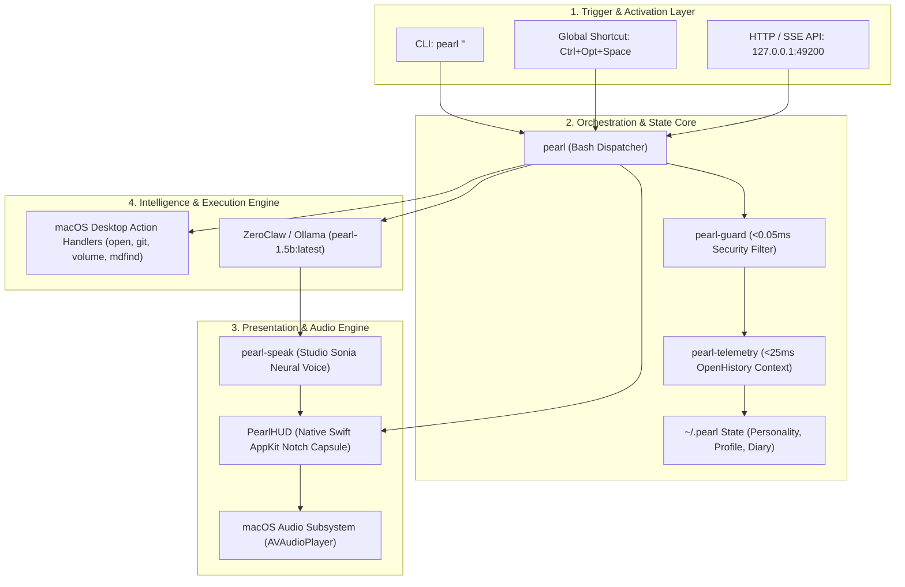

# Pearl Architecture & Data Flow

This document details the internal architecture, components, and communication protocols of Pearl on Apple Silicon macOS.

## Key Invariants
- **Zero Daemon Overhead**: When not in active conversation, Pearl components exit. 0.0 MB idle RAM.
- **Immediate Visual Confirmation**: HUD launches in under 50ms in Thinking state before LLM generation finishes.
- **Fail-Safe Single Voice**: If network voice synthesis fails, Pearl smoothly falls back to silent terminal text without switching voices or speaking mismatched answers.
