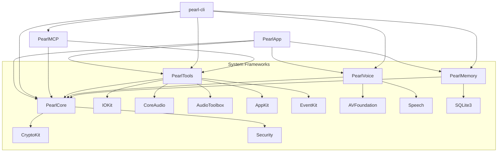

# Pearl Dependency Map & Module Architecture

**Version:** Pearl V3 Architecture Baseline  
**Platform:** macOS 26.0+ (Apple Silicon)

---

## 1. High-Level Module Hierarchy

Pearl strictly follows a layered dependency architecture. Lower layers have zero knowledge of higher layers, and circular dependencies are prohibited:

---

## 2. Module Specifications

### 2.1 `PearlCore` (Root Foundation Library)
- **Role**: Core protocol definitions, security policy engine, sandboxing, audit logging, model provider abstractions, configuration, and undo journal.
- **Dependencies**: Native macOS `Foundation`, `CryptoKit`, `Security`.
- **Key Types**:
  - `PolicyEngine`: Authorizes actions across tiers T0–T5.
  - `NeverTierValidator`: Hard blocks 13 destructive threat classes.
  - `TaintTracker`: Manages session-scoped taint state.
  - `SeatbeltProfile` & `SandboxedProcessRunner`: Apple Seatbelt process isolation.
  - `AuditLogger` & `AuditLogVerifier`: Hash-chained SHA-256 tamper-evident log.
  - `ModelProviderProtocol` (`ModelResponse`, `ModelToolCall`, `TokenUsage`).
  - `AppleFMProvider`, `FrontierProvider`, `FallbackChain`.
  - `ToolRegistry`, `PearlTool`, `ToolExecutionContext`, `ToolResult`.
  - `UndoJournal`: Actor-isolated reversibility stack.
  - `AssistantPipeline`: Canonical 16-stage request processing pipeline.
  - `ModelToolExecutor`: Centralized tool-call consumer and executor.

### 2.2 `PearlTools` (Native macOS Capabilities)
- **Role**: Concrete implementations of native macOS tools using typed APIs.
- **Dependencies**: `PearlCore`, `AppKit`, `IOKit.ps`, `CoreAudio`, `AudioToolbox`, `EventKit`.
- **Registered Tools**:
  | Tool Name | Class | Risk Tier | Reversibility | System Framework |
  | :--- | :--- | :--- | :--- | :--- |
  | `battery` | `BatteryTool` | T0 Observe | No | `IOKit.ps` |
  | `frontmost_app` | `FrontmostAppTool` | T0 Observe | No | `AppKit` (`NSWorkspace`) |
  | `git_status` | `GitStatusTool` | T0 Observe | No | `/usr/bin/git` (Seatbelt) |
  | `volume` | `VolumeTool` | T1 Reversible | Yes (restores level) | `CoreAudio`, `AudioToolbox` |
  | `open_app` | `AppTool` | T1 Reversible | Yes (terminates app) | `AppKit` (`NSWorkspace`) |
  | `screenshot` | `ScreenshotTool` | T1 Reversible | Yes (moves to trash) | `/usr/sbin/screencapture` |
  | `trash_screenshots`| `TrashScreenshotsTool`| T1 Reversible | Yes (restores files)| `Foundation` (`trashItem`) |
  | `reminder` | `ReminderTool` | T1 Reversible | Yes (removes item) | `EventKit` (`EKEventStore`) |
  | `undo` | `UndoTool` | T1 Reversible | No | `PearlCore` (`UndoJournal`) |
  | `close_app` | `CloseAppTool` | **T3 Changes**| No | `AppKit` (`running.terminate`) |
  | `git` | `GitTool` | T3 Changes | No | `/usr/bin/git` (Seatbelt) |

### 2.3 `PearlVoice` (Audio Capture, Speech & Barge-In)
- **Role**: Audio capture tap, 60 Hz waveform metering, on-device speech transcription, speech synthesis, and low-latency barge-in interruption.
- **Dependencies**: `PearlCore`, `AVFoundation`, `Speech`, `CoreAudio`.
- **Key Types**:
  - `LiveSpeechRecognizer`: `SFSpeechRecognizer` stream with endpointing.
  - `SpeechSynthesizerService`: `AVSpeechSynthesizer` wrapper with chunked playback.
  - `BargeInController`: Real-time audio RMS threshold detector (p50: 0.020 ms).
  - `SentenceChunker`: Natural punctuation streaming boundary splitter.

### 2.4 `PearlMemory` (Persistent Memory & Retrieval)
- **Role**: Structured SQLite persistence, FTS5 full-text indexing, learning gate, untrusted input rejection, and bounded context assembly.
- **Dependencies**: `PearlCore`, `libsqlite3`.
- **Key Types**:
  - `MemoryStore`: Canonical data store and file manager.
  - `FTSIndex`: SQLite FTS5 index with BM25 ranking and Porter tokenizer.
  - `LearningGate`: Rejects untrusted memory poisoning, queues proposals.
  - `ContextAssembler`: Enforces <= 600 tokens profile and <= 5 retrieved facts budget.
  - `MemoryViewer`: Statistics calculation and JSON export.

### 2.5 `PearlMCP` (Model Context Protocol Server)
- **Role**: Headless JSON-RPC 2.0 stdio server exposing safe native tools to MCP clients (Claude Desktop, Cursor, Zed, Codex).
- **Dependencies**: `PearlCore`, `PearlTools`.
- **Exposure Boundary**: Strictly limited to T0–T2 safe tools. NeverTier violations, shell execution, and write actions outside T0–T2 are hard-rejected.

### 2.6 `PearlApp` (macOS Status Item & Floating Pill HUD)
- **Role**: Resident `LSUIElement` application owning the AppKit lifecycle, menu bar status item, floating HUD panel (`NSPanel`), Carbon hotkey, and IPC socket server.
- **Dependencies**: `PearlCore`, `PearlTools`, `PearlVoice`, `PearlMemory`, `AppKit`, `SwiftUI`.

### 2.7 `PearlCLI` (`pearl` Command Line Interface)
- **Role**: User-facing CLI communicating over Unix domain socket with the resident daemon; includes standalone offline fallbacks and diagnostic commands (`pearl doctor`).
- **Dependencies**: `PearlCore`, `PearlTools`, `PearlVoice`, `PearlMemory`, `PearlMCP`.

---

## 3. Layering Invariants & Rules

1. **No Circular Imports**: Modules import only dependencies declared in `Package.swift`.
2. **Zero Direct Model Execution of Shell**: No module may execute shell strings (`/bin/sh -c`); all process invocations must use strict argv arrays via `SandboxedProcessRunner`.
3. **Zero Network Egress in Core/Memory/Tools**: Outbound network requests occur exclusively within `FrontierProvider` (to user-configured endpoints) and Sparkle updater.
4. **Isolated Memory Mutability**: The assistant persona (`persona.md`) is immutable at runtime. Stated profile and memory facts are written only through `LearningGate` with user approval.
